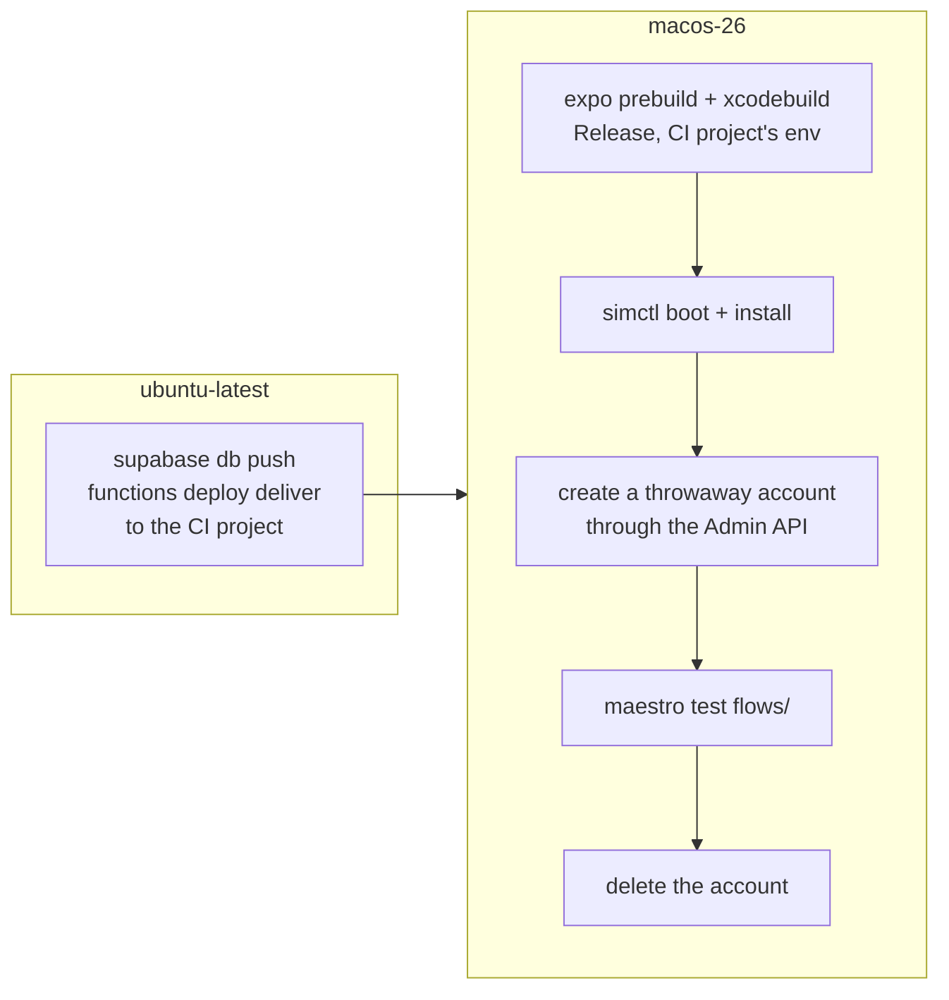

# Sketch: the Simulator tests on GitHub

Status: a sketch, not built. Today `/barry-frontend-verify` drives the app in the iOS Simulator on a Mac by hand. This page sketches how its Maestro flows could run in GitHub Actions instead.

## What blocks the obvious setup

The flows need two things at the same time: the app in an iOS Simulator, and a Supabase backend the app can reach.

- **The Simulator** runs only on macOS, so that part needs a `macos-26` runner. The repository is public, so macOS minutes cost nothing.
- **The local stack** (`npx supabase start`) needs Docker. GitHub's macOS runners are Apple-silicon virtual machines without nested virtualization, so Docker does not run there.
- **A separate job can't help directly.** The `backend` job runs the local stack on Linux, but a Linux job and a macOS job can't reach each other's ports without a tunnel.

## Options

| Option | How the app reaches Supabase | For | Against |
| --- | --- | --- | --- |
| **A. A hosted test project** (recommended) | A second hosted Supabase project, used only by CI. The app is built with its `EXPO_PUBLIC_` values. | Simple and stable. No tunnel. Uses the same migrations and `deliver` as production. | A second project to keep migrated. Its clock ticks for real, so a run must clean up after itself. Free plan: two active projects. |
| B. Linux stack plus a tunnel | The `backend` job keeps the stack running and opens a tunnel, for example Cloudflare Tunnel. The macOS job uses the tunnel's URL. | Every run starts from a fresh database. | Two jobs must wait on each other, and the tunnel is a public door to a database seeded with Vault secrets. Fragile. |
| C. Flows without a backend | Only the screens that need no server: sign-in errors, the Profile save guard, the web pages. | No backend at all. | Leaves out Start, Check-in and the Deadline, which matter most. |

## Option A in more detail

1. **Keep the CI project current.** A Linux job runs `npx supabase db push` and `npx supabase functions deploy deliver` against the CI project before the Simulator job. Secrets needed: `SUPABASE_ACCESS_TOKEN`, the CI project's database password and its ref.
   - The CI project gets no `RESEND_API_KEY` and no Twilio keys, so it never emails or texts anyone.
   - The flows prove what the app does; the messages stay `barry-backend-verify`'s job.
2. **Build the app.** The `ios` job already builds a Release `.app` for the Simulator. The Simulator job builds it with the CI project's `EXPO_PUBLIC_SUPABASE_URL` and key instead of production's.
   - The flows' `appId` is `support.barry.dev`, so they need an `APP_ID` parameter for `support.barry`.
   - Alternatively, a `ci` variant could be added to `app.config.js`.
3. **Prepare the Simulator.** Boot an iPhone, `xcrun simctl install` the `.app`, then set what the flows otherwise get from a person:
   - permissions, through Maestro's `launchApp: permissions` for notifications and location;
   - a location, with `xcrun simctl location`;
   - contacts, with `xcrun simctl addmedia booted contacts.vcf`.
4. **Create a throwaway account** with the CI project's secret key, as each `e2e/*.e2e.mjs` file does locally. Seed the Emergency Contacts and the Adventure the flows expect, and pass the email and password to Maestro as parameters.
5. **Run the flows** with `maestro test`, and upload the screenshots and Maestro's debug output as an artifact on failure.
   - Steps that the recipe does with the Simulator control tool need Maestro equivalents:
     - tapping a tab bar item: `tapOn: point`;
     - the long press on `Check In`: `longPressOn`.
   - The gotchas in `.claude/skills/barry-frontend-verify/features/` still apply, such as waiting after a sheet closes.
6. **Clean up.** Check in from any live Adventure and delete the account, in an `if: always()` step, so the CI project's clock sends nothing later.

## Open questions

- Does Maestro's tap reach the iOS 27 tab bar in a Release build? It does not in the debug build, which is why the recipe taps tabs with the Simulator tool.
- Should the job run on every pull request? It probably takes 25 to 40 minutes, so maybe only on pull requests that touch `src/`, `modules/` or the flows, plus every night.
- The Trail and the geofences need simulated movement (`xcrun simctl location start`). Is that worth automating, or does it stay a manual check?
